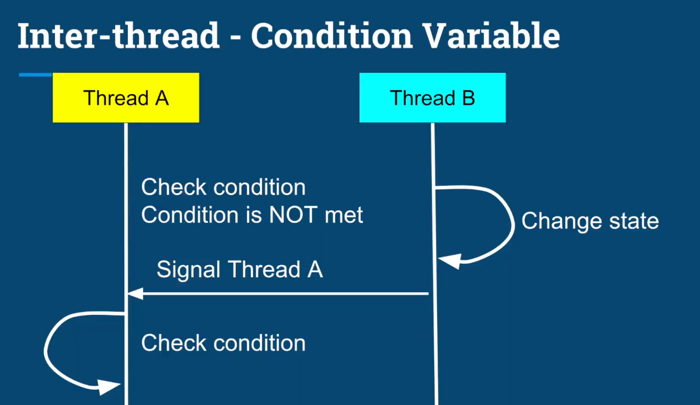
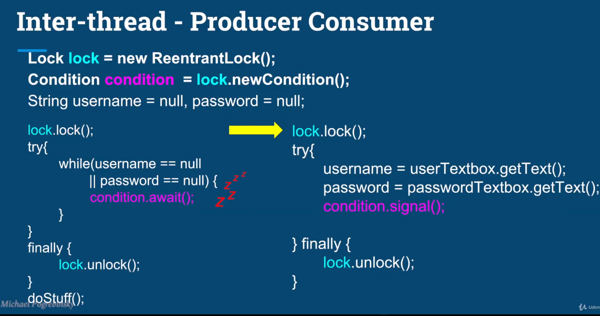
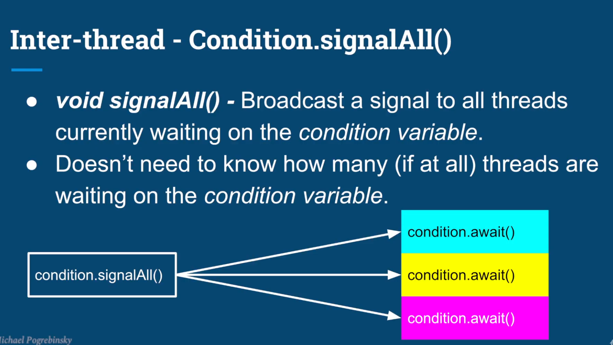

# What we learn in this lecture
- Review of inter-thread communication
- Condition variables - java.util.concurrent.locks.Condition
- Semaphore as particular case of condition variable.

## Inter-thread Communication - Semaphore as condition variable
- Calling the acquire() on a Semaphore is equivalent to checking the condition "Is number of permits >0?";
- If the condition is not met - thread A goes to sleep until another thread changes the semaphore's state.
- When thread B calls the release() method, thread A wakes up.
- Thread A checks the condition "Is number of permits >0?";
  - If it is, thread A continues to the next instruction.

## Inter thread - Creation
- Condition variables is always associated with a lock
- The lock ensures atomic check and modification of the shared variables, involved in the condition.

## Inter thread - Condition.await()
- void await() - unlock lock, wait until signaled.
- long awaitNanos(long nanosTimout)- wait no longer than nanosTimeout.
- boolean await (long time, TimeUnit unit) - wait no longer than time, in given time units.
- boolean awaitUntil(Date deadline) - wake up before the deadline date.
- void signal() - wakes up a single thread, waiting on the condition variable.
- A thread that wakes up has to re-acquire the lock associated with the condition variable.
- If currently no thread is waiting on the condition variable, the signal method doesn't do anything.

# Summary
- Reviewed some off the iter-thread communication techniques we had learned.
- Semaphore ass a particular case of condition variable
- Condition variable:
  - Condition.await() - suspend the thread, and wait for a state change.
  - Condition.signal()/signalAll() - wake all waiting threads.