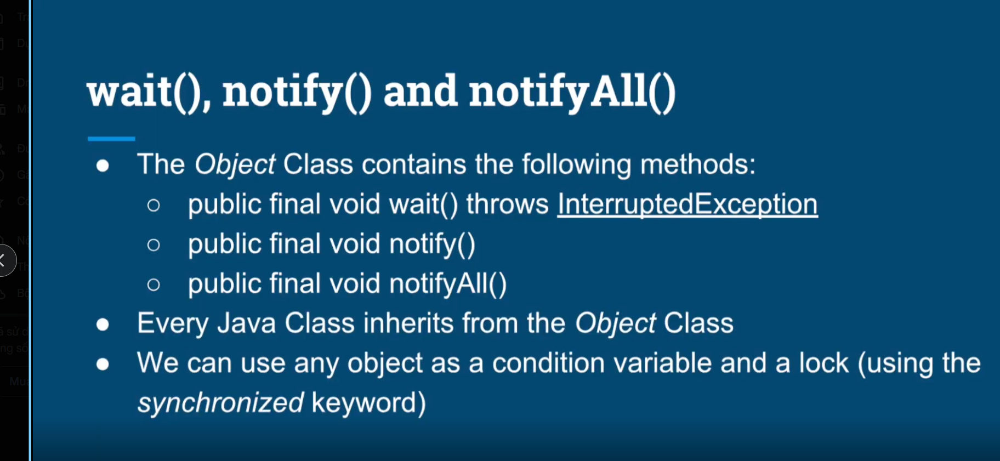
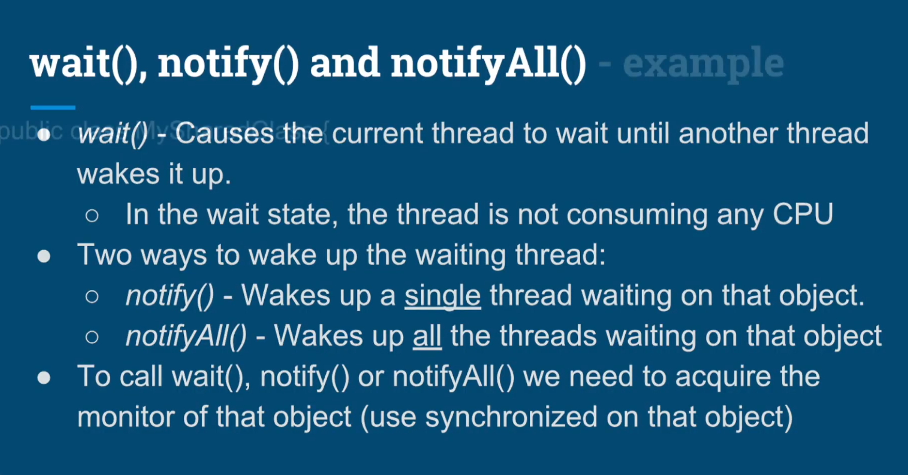
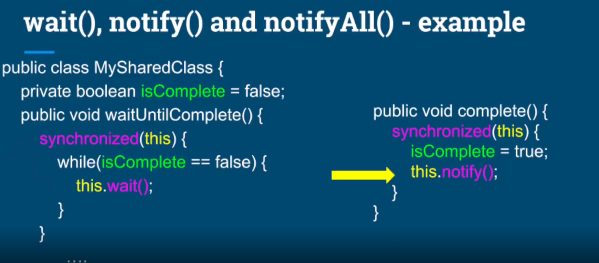
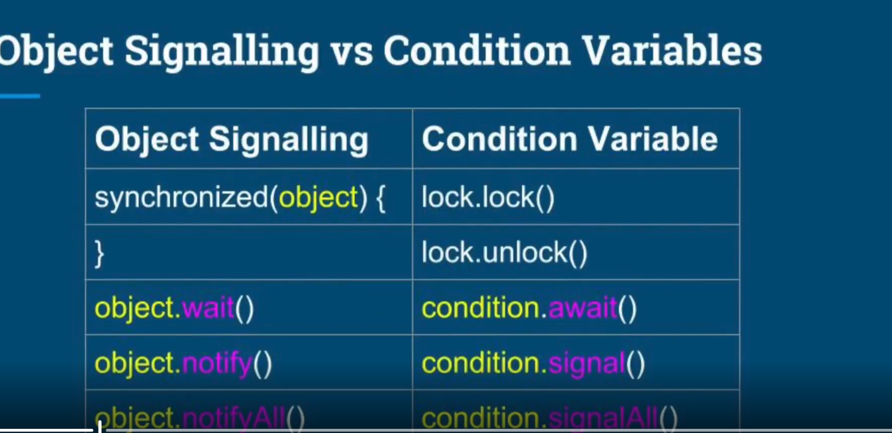

# Objects ass Condition variables - wait(), notify() and notifyAll()
## What we learn in this lecture
- wait(), notify(), notifyAll() for inter-thread communication and signalling
- Backpressure practical example between a producer and consumer.

## Summary 
- Learned another way to communicate between threads, using the wait(), notify(), and notifyAll() methods that each class hass.
- We learned how to apply it in practice, by implementing a Thread Safe Queue between Consumer and Producer threads.
- Learned how to implement back pressure to guard agianst OutOfMemoryException.
- Whenever using a queue to decouple multithreaded components, apply back-pressure and limit the size off the queue.
