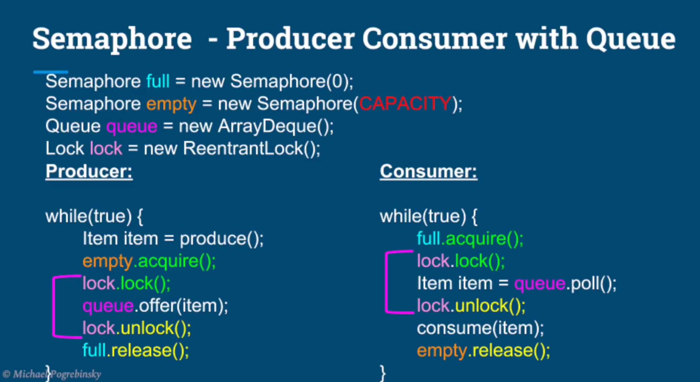

# What we learn in this lecture
- Semaphore - introduction
- Semaphores vs Locks.
- Binary Semaphores
- Producer Consumer using Semaphores

# Semaphore - introduction
- Can be used to restrict the number of "users" to particular resource.
- Unlike the locks that allows only one "user" per resource.
- The semaphore can restrict any given number of users to a resource.

# Semaphore - How to Use
```text
Semaphore semaphore = new Semaphore(NUMBER_OF_PERMITS) ;
semaphore.acquire();
```
# Semaphore - differences with locks
- Semaphore doesn't have a notion of owner thread.
- Semaphore can be released by any thread.
- Even can be released by a thread that hasn't actually acquired it.
- Many threads can acquire a permit.
- The same thread can acquire the semaphore multiple times.
- The binary semaphore (initialized with 1) is not reentrant.




# Summary
- Learned a new synchronization tool - the semaphore
- Semaphore as general case for a lock - permit issuing authority.
- Can restrict the number of users per critical section/resource.
- Differences between locks and semaphores
  - Any thread can release a semaphore ( no ownership).
- Inter-thread communication forr producer consumer, using semaphore.