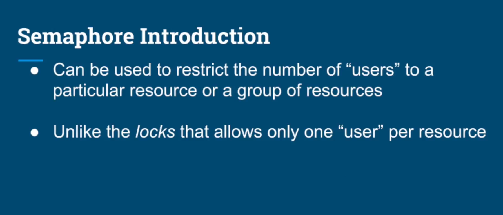

# What we learn in this lecture
- Semaphore - introduction
- Semaphores vs Locks.
- Binary Semaphores
- Producer Consumer using Semaphores

# Semaphore - introduction
- Can be used to restrict the number of "users" to particular resource.
- Unlike the locks that allows only one "user" per resource.
- The semaphore can restrict any given number of users to a resource.

# Semaphore - differences with locks
- Semaphore doesn't have a notion of owner thread.
- Many threads can acquire a permit.
- The same thread can acquire the semaphore multiple times.
- The binary semaphore (initialized with 1) is not reentrant.