# What we learn in this lecture

- Quick review of Java Thread and OS threads.
- Introduction to Virtual Threads.
- Demo of Virtual Threads.

## Quick review of Java Thread and OS threads
## Introduce the Platform threads
- The platform 
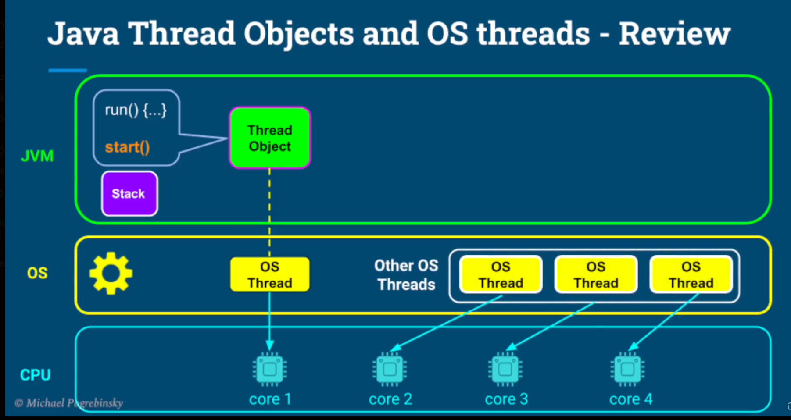
------
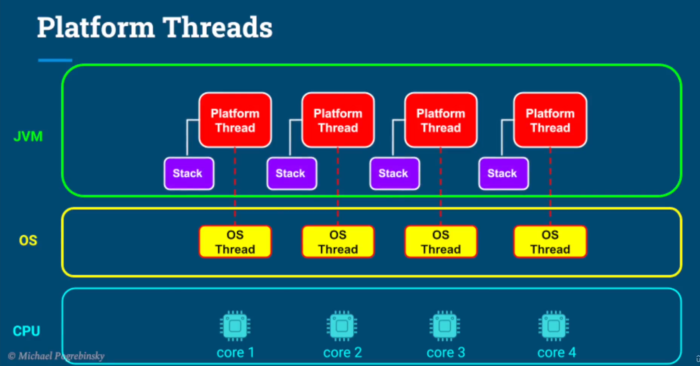
## Introduce the Virtual Threads
- Newer type of thread, introduced in JDK 21.
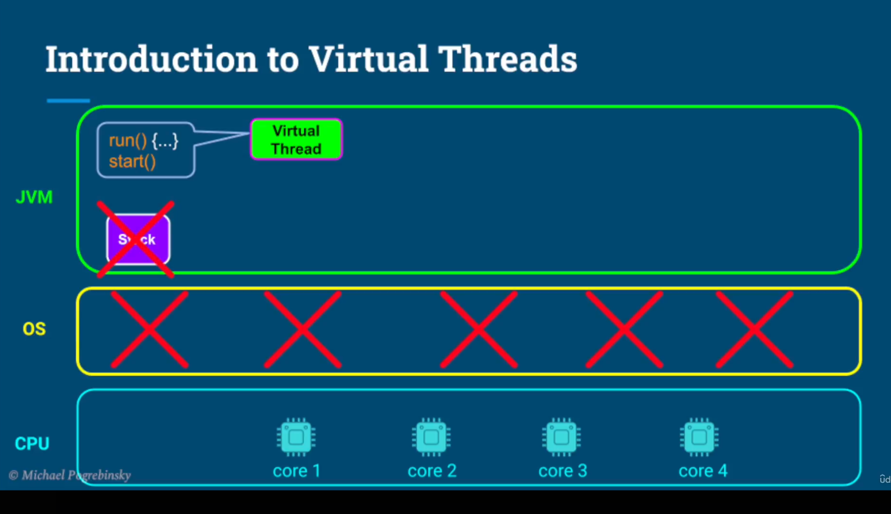
- The virtual threads is fully belong to the JVM.
- Virtual threads are like any object on the heap.
- How do they run on the CPU?
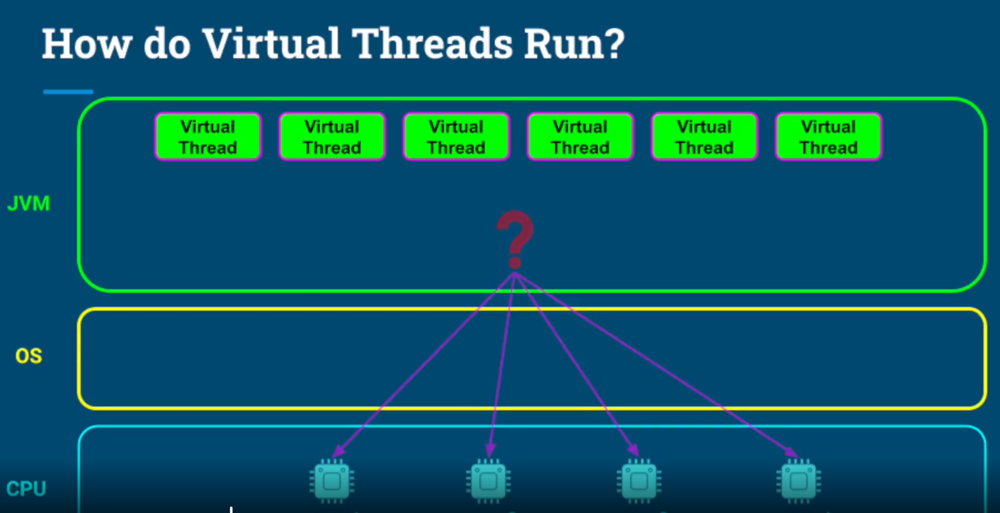

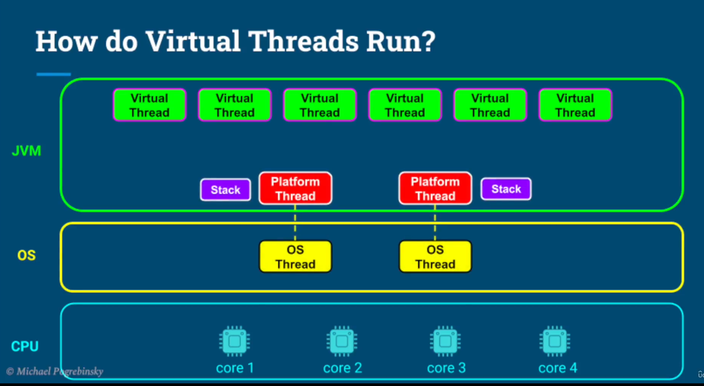
- NOw, whenever the JVm want to run the particular the VT, it will mount the VT on a PT and run it.
- The virtual thread is now call Carrier Thread.
---
- Now if the VT finishes its execution, the JVM will unmount that thread from the carrier.
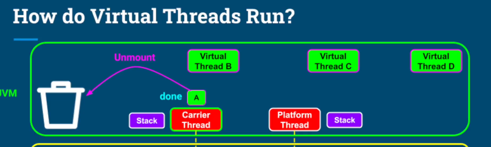
- 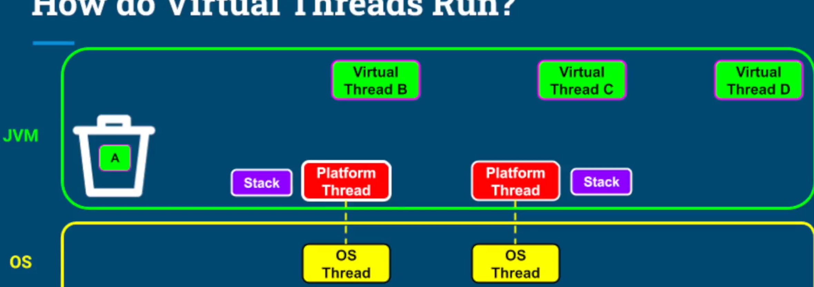
- And then makes the VT is available for other VT. The VT thread now becomes garbage. The garbage collection can clean up it anytime.
---
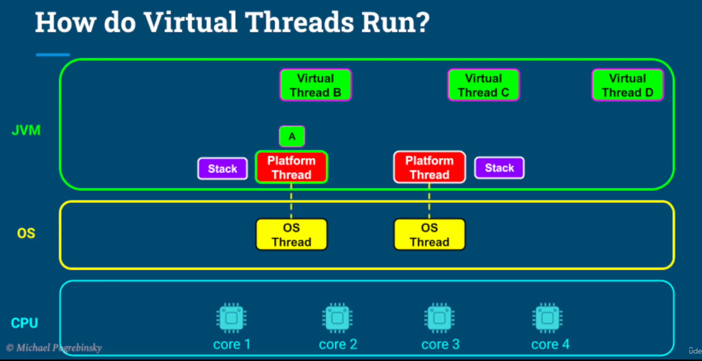
- However, if thread A is not finished but it is unable to make any progress at that time. JVM will unmounted into the heap.
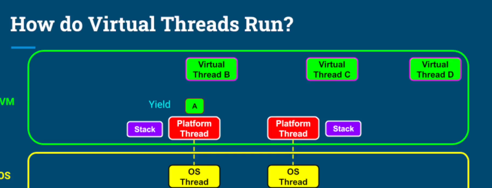
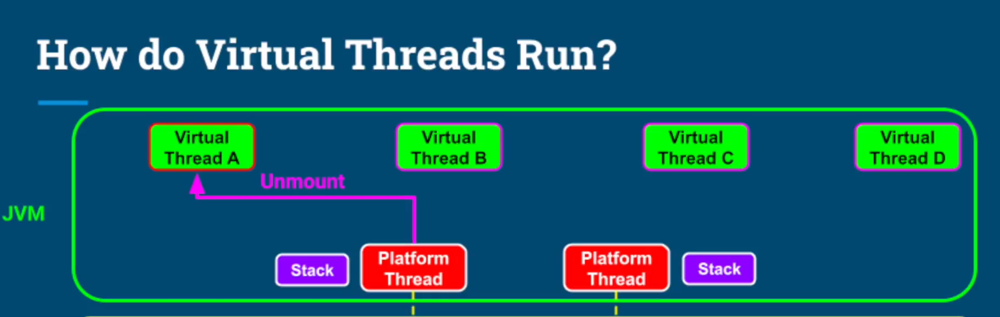
---
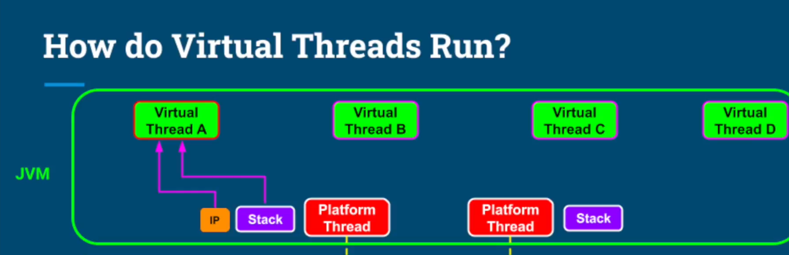
- The JVM will unmount the VT but saves its current state on the heap. That state includes its instruction pointer and `snapshot` of the carrier thread stack.
---
- If another platform thread is currently available, and does not carry any other VT, it will simply mount VT A on it.
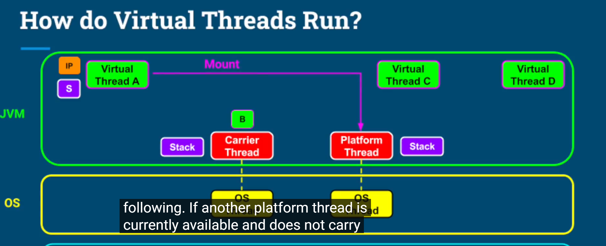
---
- copy the snapshot of the stack data from the heap back to carrier thread stack memorry.
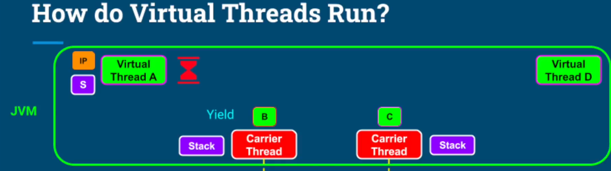
----
- Not under developers' control
- It is something that the JVM manages for us under the hood.
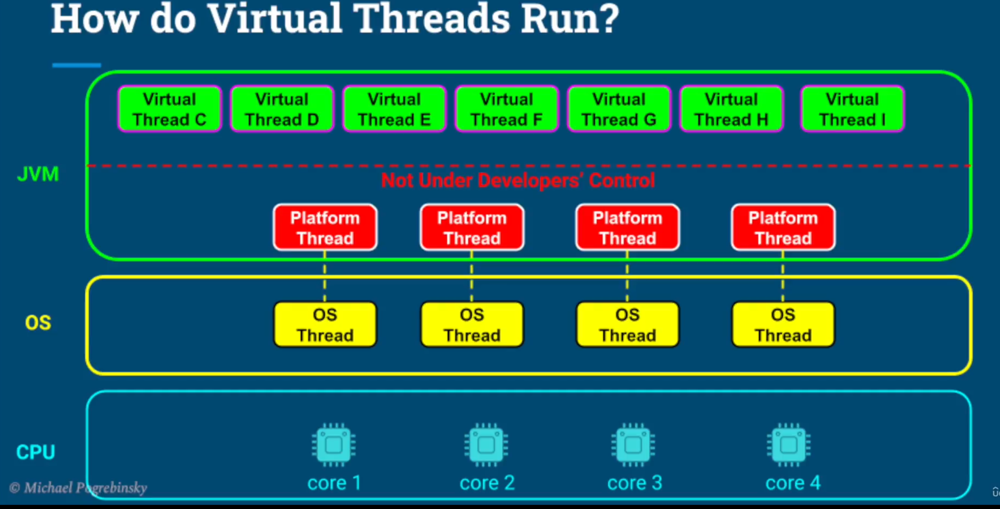
------

# Summary
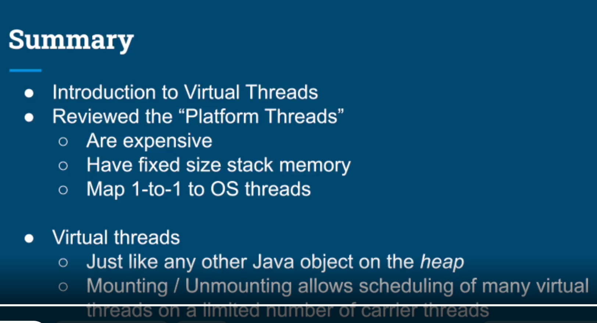

 