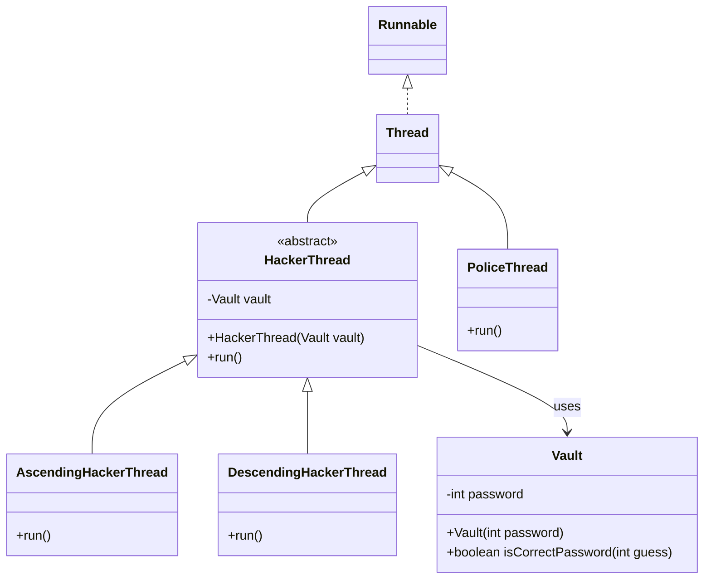

# What I learned in this course:
- 01 - Introduction
- 02 - Threading fundamentals- thread creation
- 03 - Threading fundamentals - thread coordination
- 04 - Performance Optimization
- 05 - Data Sharing between Threads
- 06 - The Concurrency Challenges & Solutions
- 07 - Advanced locking
- 09 - Lock-free Algorithms, Data - Structures & Techniques.
- 10 - Threading models for high performance IO
- 11 - Virtual threads and high-performance IO
- 12 - Beyond Multithreading - Final lecturer.

